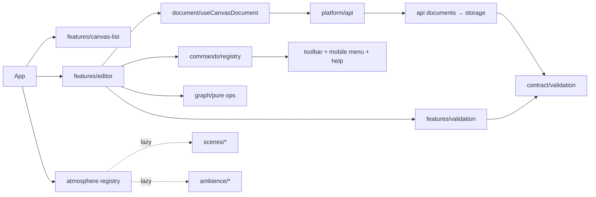

# Canvas: code review and target architecture

Reviewed: branch `stable-foundation` at `bae6860`, 2026-11-10.
Evidence labels: **Confirmed** (read in code or measured) and **Inference** (likely, not measured).

## Verdict

The base is sound. TypeScript runs in `strict` mode with `noUncheckedIndexedAccess`.
There is no `any`, no `eslint-disable`, and no TODO debt. Theme tokens are complete.
Tests cover the contract, the API, and the main editor flows (131 unit, 48 E2E).

The debt is concentration. Four files hold most of the risk:

| File | Lines | Problem |
| --- | --- | --- |
| `web/src/canvas/editor/CanvasEditor.tsx` | 2,286 | 38 `useState`, ~90 handlers, 45 imports, 11 concerns |
| `web/src/styles.css` | 6,660 | One global sheet; 229 validation selectors; 77 selectors defined 2–4 times |
| `web/src/canvas/backdrop/scenes.ts` | 1,883 | Five scenes plus all pixel helpers in one file |
| `web/src/ambience/ambience.ts` | 1,573 | Twelve audio loops in one file, loaded eagerly |

## Findings

Ranked by consequence. Each has a proof seam for the fix.

### Correctness and safety

1. **Cognito mode is a stub.** Confirmed. `authenticate()` returns `null` for `cognito`, so every request
   would return 401. `principalFromClaims` is unused and hard-codes `tenantId: 'local'` for every user.
   Any non-local deployment is blocked, and a naive fix would put all users in one tenant.
   *Fix:* verify Cognito JWTs (issuer, audience, expiry, JWKS) and derive the tenant from a claim.
   Needs an Aegis review. *Proof:* API tests with a signed test token, a wrong audience, and an expired token.
2. **S3 saves can lose updates under concurrency.** Confirmed. `S3CanvasStore.save` reads the ETag, compares it,
   then calls `PutObject` without a condition. Two API instances can both pass the check.
   *Fix:* conditional `PutObject` (`IfMatch` on the object ETag). *Proof:* store test with two interleaved saves.
3. **CORS defaults to `*`.** Confirmed. That is safe with bearer tokens, but it should be explicit per environment.
4. **The full validation pipeline runs on every drag frame.** Inference. `useProfileValidation` depends on
   `nodes`, which change on every position update. Each pass rebuilds the canvas and meta-validates every
   schema card with Ajv. *Fix:* key validation on content, not positions, or defer it.
   *Proof:* a frame-time probe on a 100-card canvas.

### Structure and duplication

5. **One god component.** Confirmed. `CanvasEditor` owns persistence, history, selection and groups,
   snapping, layout, screenshot capture, linked canvases, validation, suggestions, edge editing, and
   eight dialogs. Domain logic (group drag, snapping, canvas-link management)
   sits inline in event handlers.
6. **Repeated mutation patterns.** Confirmed. "Deselect all, append node, mark dirty" appears 9 times.
   `nodeDimensions → box` mapping is repeated. There are 8 `as CanvasNode`-style casts.
7. **Two toolbars, one command list.** Confirmed. `CanvasToolbar` takes 34 props and renders separate
   desktop and mobile trees. Commands are also listed again in `shortcuts.ts` and the help dialog.
   A new command needs edits in 3 or 4 places.
8. **Validation lives in three layers and ten files.** Confirmed. Profile rules are in the contract package.
   JSON Schema checks are in `web/canvas/schema`. Semantic rules are in `web/canvas/semantics`. Presentation,
   priority, suppressions, identity, and suggestions are spread over 7 files in 4 folders. The API cannot
   reuse the web-only rules.
9. **Store logic copied three times.** Confirmed. Memory, file, and S3 stores each re-implement ETag checks,
   conflict errors, and document stamping (10 matching sites in each store). A semantics change needs 3 edits.
10. **Theme facts in four places.** Confirmed. `themes.ts` (metadata), `themes.css` (tokens),
    `CanvasBackdrop.sceneForTheme` (scene map), and the E2E theme list. Adding a theme means 4 edits.
11. **Pixel-art helpers duplicated.** Confirmed. `auroraShore.ts` re-implements `rgb`, `mix`, bands,
    dithering, glow sprites, and stars from `scenes.ts`. This was deliberate to avoid merge conflicts
    while two checkouts edited `scenes.ts`; it should now be removed.
12. **Heavy code loads eagerly.** Confirmed. Tiptap (509 kB chunk) is imported by every card component.
    All scenes and all ambience loops load for every theme.
13. **`mcp/` is a one-line scaffold.** Confirmed. It runs in every build, lint, and test. It is noise until
    there is an MCP plan.

### Styling

14. Global class names in one sheet, with later blocks overriding earlier ones (four "readability" layers
    for the warnings panel). 12 distinct `@media` breakpoints. About 38 classes are never referenced.
    Tokens are good: every `--ui-*` variable used is defined in all 20 themes, and only 17 colours are
    hard-coded.

## Target architecture

Feature-first folders. Composition roots wire focused modules; pure model code has no React.
No new state library: React Flow already owns node state, and domain hooks group the rest.

```text
web/src/
  app/            App shell, routes (navigation.ts), providers, topbar
  platform/       api client + mock, auth, safe storage, media queries
  design/         tokens.css (per theme), base.css, theme registry, UI primitives (Button, Dialog, Select)
  atmosphere/     theme → scene → ambience registry, lazy-loaded per theme
    pixel/        shared kit: color, bands, dither, glow, noise, stars
    scenes/       duneNight.ts, duneDay.ts, tide.ts, ember.ts, gargantua.ts, auroraShore.ts
    ambience/     one file per loop + the Web Audio engine
  features/
    canvas-list/  list page, search, delete, rename
    editor/
      CanvasEditor.tsx   composition only (target < 300 lines)
      document/   useCanvasDocument: load, autosave, retry, conflicts, merge, leave guard, history
      graph/      pure ops: insertNodes, group, duplicate, nudge, snap, moveGroupMembers, edge ops
      commands/   one registry: id, label, icon, shortcut, enabled(), run() → toolbar, mobile menu, help
      cards/      card components, NodeShell, MarkdownEditor (lazy), CodeBlock
      capture/    screenshot and area selection
      links/      linked canvases and trail
      layout/     auto layout, data-flow layout
    validation/   useValidation (content-keyed), presentation, suppressions, panels
    views/        derived views and sequence diagrams
    schema/       JSON Schema workbench UI
packages/canvas-contract/
  validation/     profile, schema-contract, and semantic rules (shared by web, API, MCP)
api/src/
  documents/      repository: ETags, conflicts, stamping (once)
  storage/        blob adapters: memory, file, S3 (conditional writes)
  auth/           local token, Cognito JWT verifier, tenant from claims
```



Rules for new code:

- Pure logic goes in `graph/`, `contract/`, or `pixel/` with unit tests. Components only wire it.
- A user action is added once, in `commands/`. Toolbar, mobile menu, shortcuts, and help read from it.
- A theme is added once, in the atmosphere registry plus its token block.
- Feature CSS lives next to its feature and uses tokens only. Breakpoints: `--bp-phone` (720px) and
  `--bp-short` (landscape phones).

## Phased plan

Each phase keeps behaviour the same and ends green: typecheck, lint, unit, E2E, build, plus a browser check.
The 48 E2E tests are the safety net for the editor split, so Phase 0 adds the missing guardrails first.

| Phase | Work | Risk it removes | Proof |
| --- | --- | --- | --- |
| 0. Guardrails | `make verify`; CI workflow; E2E check that every scenic theme draws a non-blank backdrop | Silent breakage during refactors | CI run green |
| 1. Quick wins | Delete unused CSS and dead exports; lazy-load `MarkdownEditor`; `insertNodes()` helper; remove `mcp/` or give it a plan | Bundle size, repeated code | Bundle < 500 kB; E2E green |
| 2. Atmosphere | Theme registry; shared `pixel/` kit; one file per scene; lazy-load scene and ambience per theme | 4-place theme edits; 1,900-line file; duplicate helpers | Backdrop E2E per theme; visual compare |
| 3. Editor split | `document/`, `graph/`, `commands/`, `capture/`, `links/`, `validation/` extracted in that order | God component; duplicate toolbars | E2E green after each extraction; editor < 300 lines |
| 4. Contract and API | Move rules into contract; content-keyed validation; document repository; conditional S3 writes | Concurrency loss; drag-frame cost; rule drift | Store race test; frame-time probe |
| 5. Styles | Co-locate CSS per feature; merge layered blocks; two named breakpoints | Override chains; 6,660-line sheet | Visual check per theme, phone and desktop |
| Later | Cognito JWT verification with real tenants | Deployment blocker | Aegis review; signed-token tests |

## Decisions needed

1. **One main line.** `stable-foundation` should become the only line where Canvas code changes. The original
   checkout still has uncommitted backdrop work that opencode keeps editing. Phase 2 splits `scenes.ts` into
   files, after which patch syncs stop working. Recommended: commit or stop the opencode work, then continue
   only here.
2. **Atmosphere scope.** Keep all 20 themes and 12 ambience loops, or trim them. Lazy loading makes the
   runtime cost small either way, so this is about product focus, not performance.
3. **`mcp/`.** Delete it now, or define what the MCP server should do.
